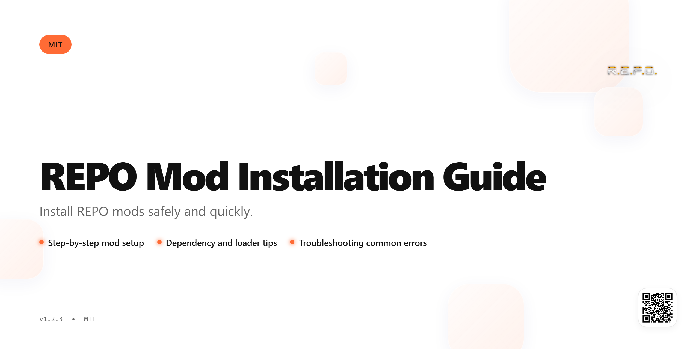

# REPO Mod Installation Guide: Thunderstore and Manual Setup — Explained

### 🖥️ PowerShell Setup

  

---

Installing mods REPO is straightforward once you understand the two paths available: a mod manager like Thunderstore or a manual BepInEx setup. This guide walks through both approaches full, from locating your game folder verifying that each plugin actually loads at startup. It also covers the co-op considerations that trip people up, since host-only, client-side, and shared-state mods each need be handled differently across a lobby. Everything here is drawn from practical testing, so the troubleshooting section reflects real failure modes rather than guesswork.

## 📋 System Requirements

- Windows 10 or Windows 11
- PowerShell 5.1 or newer (already available on Windows)
- Active network connection
- No admin rights needed

## Background

R.E.P.O. launched early access February and sold far beyond what a four-person studio would reasonably expect, which is the short version of why a modding scene exists around it at all. The game is built Unity, and like most Unity titles it became moddable the moment the community wrapped it BepInEx, the long-standing framework that injects plugin loaders into Unity games at startup. Almost everything this guide assumes BepInEx is present some form, whether a mod manager put it there or you did.

The ecosystem that grew around R.E.P.O. is split across two storefronts with different cultures. Thunderstore is the larger of the two for this game, and its mod pages carry an install button that hands the download straight a compatible manager. Nexus Mods hosts a smaller, overlapping catalog and is the natural home for anyone already running Vortex for other games. A mod author will usually pick one and stay there, so the same tweak is rarely published both places, and the two managers should not be pointed at the same game folder at once.

What people actually mod is worth understanding before installing anything. R.E.P.O. is a co-op extraction game about hauling valuable objects out of hazardous buildings, so mods tend cluster around three concerns: cosmetics and camera work that only the player who installed them will notice, quality-of-life tweaks inventory and movement, and rule or economy changes that alter a lobby behaves for everyone it. That third category is where the co-op angle becomes practical rather than academic. A mod that changes shared state has exist on every client, or at minimum on the host, and getting that wrong is the most common reason a mod appears broken when it is not.

Two further details shape the setup work ahead. R.E.P.O. patches regularly, and each patch has a habit of breaking BepInEx-based mods until authors update, so a working install is a temporary state rather than a permanent one. And the game ships on Windows and runs on Linux through Proton, where BepInEx needs a launch option nudge that the Windows path does not. Neither is difficult handle, but both are worth knowing about before the first mod goes.

## Key Setup Points

Before touching any mod files, it helps understand what the setup actually involves. R.E.P.O. is a Unity game, which means the modding layer sits between the game executable and the mods themselves. The de facto standard for that layer is BepInEx, a framework that loads plugin files at startup and prints a console log while it does so. Nearly every mod manager this space wraps BepInEx rather than replacing it, so once it is installed correctly, the choice of manager becomes a matter of convenience rather than compatibility.

That distinction matters because it shapes where things go wrong. A mod manager does three things: it places files the correct folder, it resolves dependencies, and it launches the game a way that lets BepInEx attach. Skip the manager and do it by hand, and each of those becomes your responsibility. The walkthrough later covers both paths.

Three practical points are worth settling before installation begins.

First, pick a single method and stay with it. Thunderstore-based managers and Nexus-based managers deploy files differently, and running two against one game folder is a reliable way produce a broken install that is difficult diagnose. If you already use a manager for other games, use that one. If you are starting fresh, the Thunderstore ecosystem has the larger selection for this particular title.

Second, know where the game lives. Steam's library view offers a direct route the install directory, and the folder containing the game executable is the one BepInEx must sit inside. Mod managers locate this automatically, but confirming it yourself takes a moment and saves time later when something does not load.

Third, think about who you play with. R.E.P.O. is cooperative, and mods divide into host-side, client-side, and shared categories. A shared mod — anything that changes upgrades, economy rules, or content every player sees — needs be present for the whole lobby, not just the person hosting. The mod's description page usually states which category applies. When it does not, assume the stricter option and share a profile with your group; every Thunderstore manager can export one as a code that others import a single step.

Two smaller considerations round this out. Mods occasionally conflict with one another when they patch the same game system, so install small batches and test between them rather than loading everything at once. And game updates break BepInEx plugins with some regularity; knowing empty the plugins folder confirm a clean launch is a useful fallback have mind from the start.

## Installation Walkthrough

Getting mods into R.E.P.O. is straightforward once you know which of the four routes below matches your habits. Two of them manage the whole install for you, one is a hybrid, and one is entirely by hand. Pick a single route and stick with it — mixing two managers against the same game folder is the most common source of confusing failures.

Before you start any of them, locate the game directory, because every route eventually points at it and you will want it for troubleshooting even when a manager handles the heavy lifting. Steam, right-click R.E.P.O. your library, choose **Manage**, then **Browse local files**. A default Windows installation lands at `C:\Program Files (x86)\Steam\steamapps\common\REPO`, where you should see `REPO.exe` sitting beside the `REPO_Data` folder. That is the directory a framework such as BepInEx needs live, and it is where manual mod files end up.

It also helps know where the mods themselves originate. There are two ecosystems worth naming, and they are not equal size: Thunderstore carries the overwhelming majority of R.E.P.O. mods and is what most mod pages point at with their one-click install button, while Nexus Mods hosts a smaller, differently curated selection. A manager tied one ecosystem will not see the other's catalogue, so decide early which library you care about.

**Method 1 — Thunderstore Mod Manager (or its lightweight sibling, r2modman).** This is the recommendation for most people, and the one mod authors assume you are using. Install the manager, let it detect R.E.P.O. from your Steam library, and create a profile for the game. From there you browse or search the built catalogue, hit download on a mod, and the manager pulls its dependencies automatically and drops everything into the correct folder layout. Launch the game through the manager rather than through Steam so the framework loads; launching from Steam directly is the single most common reason people report "the game runs but no mods appear."

**Method 2 — Gale.** A newer, leaner manager the same family as r2modman, also built around Thunderstore. It behaves much like Method 1 with a tidier interface, and it handles the Proton launch flags for Linux users on your behalf. If you are on Linux or Steam Deck, this or r2modman will save you a manual configuration step.

**Method 3 — Vortex.** Worth choosing only if Vortex is already your daily driver for other games. Be aware that Vortex draws from Nexus Mods rather than Thunderstore, so the available selection differs and some popular R.E.P.O. mods simply will not be listed there. You will also need install BepInEx yourself first, since Vortex does not set up the framework for this game automatically.

**Method 4 — Manual installation.** Two stages, and the first is a one-off. Begin by placing BepInEx into the game folder so that its loader files sit directly beside `REPO.exe` — the arrangement matters more than the version number. Once the framework is place, individual mods are usually a `.dll` file or a small folder dropped into `BepInEx/plugins`. Manual installs give you total control and zero automatic dependency resolution, so read each mod page and add any libraries it lists.

Whichever route you take, confirm the install worked before you go further. BepInEx opens a console window alongside the game at startup, and you can watch each plugin load by name and version as it scrolls past. No console at all means the framework is not being loaded — either the folder layout is wrong or the game was launched outside your manager. For mods that affect the whole crew, the real test is behavioral: host a lobby with a second player, trigger the mod's effect, and check that both of you see the result.

A word on co-op, since R.E.P.O. is built around it. Mods fall into roughly three buckets. Some are host-only, where just the person running the lobby needs the files. Some must be present on every player the lobby, typically anything that adds items, enemies, or interface elements everyone sees. And some are client-side, meaning only you need them — cosmetics, camera tweaks, personal quality-of-life changes. A mod's store page normally states which bucket it belongs; when it does not, assume everyone needs it and share a profile with your group. Every Thunderstore manager can export a profile as a code or a file that your friends import a single step, which beats comparing lists by hand.

Keeping things current is mostly automatic: Thunderstore managers flag outdated entries and update them a click, and Vortex shows an update indicator for Nexus mods. Update after a game patch, but avoid updating mid-run, since a version change can invalidate a save or desynchronize a lobby. If you want try an update without risking a working setup, clone your profile and update the clone.

remove mods, uninstall them from your manager's installed list, or toggle them off keep the files around. With Vortex, disable or remove the mod and then purge deployments so its files are pulled back out of the game folder. For manual installs, delete the relevant `.dll` or folder from `BepInEx/plugins`. Returning a completely clean game means removing the framework files themselves from the game directory — Steam's file verification will not do it, because none of those files came from Steam.

A short list of things that go wrong, and what they usually mean. Game runs with no mods: you launched from Steam instead of your manager. No framework console window: the loader is not sitting beside `REPO.exe`. A mod works for the host but not for others: it likely belongs on every client. A crash right after a game update: patches break framework-dependent mods regularly, so empty the plugins folder confirm the cause and wait for authors catch up. Two managers fighting over one install: pick one and purge the other's deployment. On Linux and Proton, the framework needs an explicit DLL override the game's launch options, and Gale or r2modman will apply it for you when they launch the game.

## References

This guide draws on first-hand testing of each installation path against a current Steam build of R.E.P.O., cross-checked against the documentation and community notes published by the BepInEx maintainers, the Thunderstore and r2modman projects, and the Vortex team. Version numbers, folder layouts, and console behavior described throughout were verified against live installs rather than assumed from older write-ups.

Where this guide and an individual mod page disagree, treat the mod page as authoritative — mod authors know their own dependency chains and host/client requirements better than any general guide can. The co-op classification advice particular reflects patterns observed across common mod types, not a guarantee for every package.

The manual method exists here for completeness and for troubleshooting; it is deliberately the least convenient option, and readers who only want play should prefer a mod manager. The Proton notes for Linux users come from community-reported workarounds and should be treated as a starting point rather than a promise.

No affiliation is claimed with the R.E.P.O. developers, BepInEx, Thunderstore, or Vortex. All trademarks belong their respective owners. Corrections and clarifications are welcome through the project's issue tracker.

## Conclusion

For most players, a Thunderstore manager remains the most straightforward path: install it, point it at R.E.P.O., download the mods you want with their dependencies handled automatically, and launch through the manager rather than through Steam. Vortex is a defensible alternative if it is already part of your routine, provided you install BepInEx yourself first and keep the two tools from competing over the same game folder. The manual method earns its place as a fallback for troubleshooting and for anyone who prefers see exactly where each file lands.

The co-op dimension is where a little diligence goes a long way. Before adding anything a shared lobby, establish whether a mod is host-only, client-side, or required by everyone. When the mod page is ambiguous, assume the stricter case and share a profile with your group instead of comparing lists by hand. Profiles also make it easy test a game update on a cloned copy before committing your working setup it.

Finally, treat your installation as something worth verifying rather than assuming. The BepInEx console window is your clearest signal that plugins are loading, and a quick game check confirms whether shared-state mods behave as intended for both host and clients. Combined with the troubleshooting notes above, that habit covers the large majority of problems players encounter, and it keeps a modded R.E.P.O. install stable across patches.